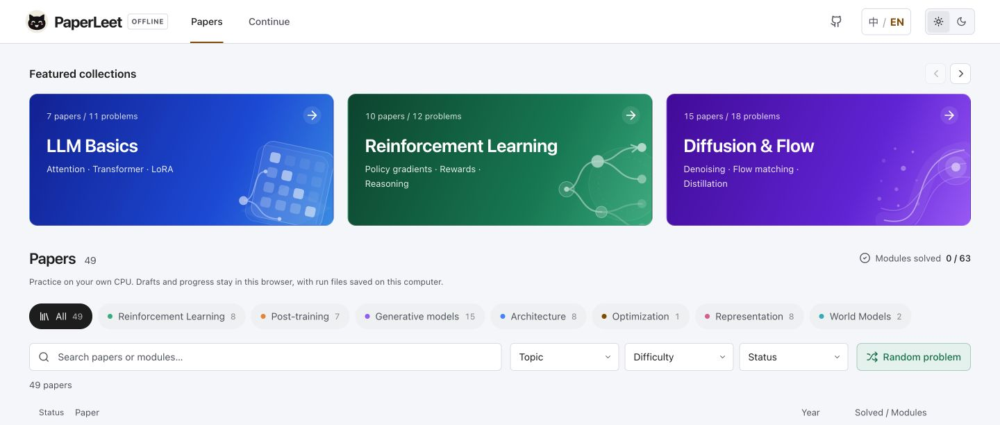
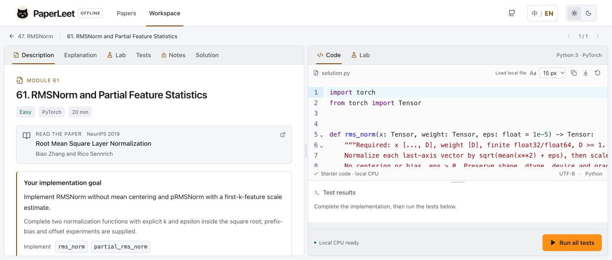

# PaperLeet Offline

<picture>
  <source media="(prefers-color-scheme: dark)" srcset="web/public/brand/paperleet-logo-dark.svg">
  
</picture>

**English** | [简体中文](README.zh-CN.md)

**Turn research papers into working code. Practice on your own CPU.**

PaperLeet is a paper-to-code practice library: read a method, implement its core functions, and test what you understood. This open-source offline edition brings a paper library, Python editor, mathematical checks, and small teaching experiments to your computer.

**49 papers · 63 exercises · 491 layered checks · 257 intentional buggy implementations · MIT**

Explore attention and modern LLM building blocks, reinforcement learning, diffusion and flow, post-training, representation learning, and world models. Each exercise includes English and Chinese explanations, a starter, a reference solution, tests, and notes on common mistakes. Python/PyTorch executes locally; you need no GPU, account, or cloud API.

[Quick start](#quick-start) · [First exercise](#your-first-exercise) · [Learning paths](#choose-a-learning-path) · [All 49 papers](#full-curriculum) · [How tests teach](#learn-from-four-layers-of-tests) · [Contribute](#contribute)



## What you can learn here

| In an exercise | What it helps you understand |
| --- | --- |
| Implement the paper's selected core functions | Connect an equation to tensor shapes, masking, normalization, and gradient flow. Supporting code is supplied. |
| Compare against independent properties and a reference | Find errors that produce plausible outputs but violate the method's mathematics. |
| Inspect deliberate buggy variants | See which checks catch a sign error, a detached gradient, a wrong axis, or an incorrect boundary condition. |
| Explore an interactive lab and small CPU experiments | Relate a formula to observable behavior, then compare the reference with artifacts from your own tests. |
| Work through a paper's required modules | Build an implementation one mechanism at a time, with progress visible in the local interface. |

The exercises assume some Python and familiarity with tensors. Basic PyTorch broadcasting and automatic differentiation are useful starting points. The scope is a paper's selected algorithms: supporting infrastructure is provided, and the experiments use small workloads suitable for local practice.

## Quick start

Use **Python 3.10+**, **Node.js 20.19+**, Git, and `make`. The commands below work in a macOS/Linux shell; on Windows, use WSL for this startup workflow. Dependency installation needs internet access. Ordinary practice after setup runs locally, including the editor's assets and the Python test runtime.

```bash
git clone https://github.com/Hongyang-Du/PaperLeet.git
cd PaperLeet
python3 -m venv .venv
source .venv/bin/activate

# Optional on Linux: install CPU-only PyTorch before the project dependencies.
# python -m pip install torch --index-url https://download.pytorch.org/whl/cpu

python -m pip install -e .
npm --prefix web ci
make dev
```

Open **http://127.0.0.1:5173**. `make dev` exports the current catalog and starts both the frontend and local judge. The status beside **Run all tests** at the bottom of the exercise editor shows **Local CPU ready** when the judge is available.

On later visits, run `make dev` from the repository root. **Ctrl-C stops both services.** The frontend listens on `127.0.0.1:5173`, and the judge on `127.0.0.1:8765`. Judging is serialized to one running job; the test fixtures use two PyTorch CPU threads.

For terminal-only practice, the Python installation is enough; skip the npm and `make dev` steps and use the [CLI commands](#practice-in-your-editor-or-terminal) below.

## Your first exercise

A good starting point is [**61 · RMSNorm**](problems/architecture/rms_norm/README.en.md), [**22 · Scaled Dot-Product Attention**](problems/architecture/attention/README.en.md), or [**6 · Forward Noising**](problems/diffusion/schedules/README.en.md).

1. Open a paper from the library or a learning collection, then choose a module.
2. Read its goal, tensor conventions, and **required functions**. The starter supplies the supporting functions.
3. Complete the implementation and select **Run all tests**. The code runs in native Python/PyTorch on your CPU.
4. Read the failing check's explanation and expected/actual values. Open **Lab** to inspect the relevant behavior, revise your code, and run again.
5. Pass all required checks to mark the module complete and unlock **Notes**. Compare your implementation with the expandable **Solution** when you want to review another approach.



The screenshots show the English interface. On your first visit, the app follows your primary browser/system language: Chinese for a Chinese locale, English otherwise. The language toggle switches the interface, statements, and explanations between English and Chinese, and remembers your choice. You can also choose a light or dark theme, adjust the code font, and resize the description, editor, and results panels.

Completing a paper means passing its selected required modules. Paper IDs and exercise IDs are separate: the library contains papers **1–49** and exercises **1–63**. A subset of passing tests does not mark an exercise complete. A later failed run does not remove an earlier accepted result from this browser's progress.

## Choose a learning path

The library has six featured collections. The sequences below are suggested starting orders; follow a paper's prerequisites when you need more background. Collections overlap, so a paper can support more than one path.

| Collection | Suggested progression | First exercise |
| --- | --- | --- |
| **LLM Basics** | Attention → Transformer blocks → RMSNorm → RoPE → GQA → FlashAttention → LoRA | [Scaled dot-product attention](problems/architecture/attention/README.en.md) |
| **Reinforcement Learning** | GAE → PPO → GRPO → Dr. GRPO → GSPO / DAPO → feedback-based objectives | [GAE recurrence](problems/rl/gae/README.en.md) |
| **Diffusion & Flow** | Forward noising → parameter conversions → DDPM / DDIM sampling → Flow Matching → distillation | [Forward noising](problems/diffusion/schedules/README.en.md) |
| **Post-training** | LoRA → QLoRA → DPO → on-policy distillation → OPSD / SDPO / DistiLLM-2 | [Low-rank adaptation](problems/finetuning/lora/README.en.md) |
| **JEPA / World Models** | VICReg → I-JEPA → SIGReg / VISReg → latent prediction → planning and Causal-JEPA | [VICReg losses](problems/representation/vicreg/README.en.md) |
| **Visual Generation** | CLIP → Rotation Trick → VAR → REPA → Drifting / FD-Loss | [CLIP contrastive loss](problems/representation/clip/README.en.md) |

Use collection pages, search, category and difficulty filters to narrow the library. **Random problem** picks an unattempted exercise within the current collection and filters. **Continue** returns you to unfinished practice.

## Coverage at a glance

These are the catalog's primary categories; the featured collections above intentionally overlap.

| Area | Papers | Exercises | Examples |
| --- | ---: | ---: | --- |
| Reinforcement learning | 8 | 9 | GAE, PPO, GRPO, DAPO, GSPO, PKPO |
| Post-training and fine-tuning | 7 | 8 | LoRA, QLoRA, DPO, OPSD, SDPO, DistiLLM-2 |
| Generative models | 15 | 19 | DDPM, DDIM, Flow Matching, Consistency, DMD, MeanFlow, FD-Loss |
| Architecture and inference | 8 | 15 | Transformer, FlashAttention, Kimi K3 modules, RMSNorm, GQA, RoPE |
| Optimization | 1 | 1 | AdamW |
| Representation learning | 8 | 8 | CLIP, REPA, VICReg, SIGReg, VISReg, I-JEPA |
| World models | 2 | 3 | LeWorldModel, Causal-JEPA |
| **Total** | **49** | **63** | |

## Full curriculum

Each method below links to its first exercise. The local paper page groups all of that paper's modules and explains the selected scope. [papers.yaml](papers.yaml) is the curriculum's source of truth.

<details>
<summary><strong>Expand all 49 papers and their implementation scopes</strong></summary>

| Paper | Method | What you implement | Exercise IDs |
| --- | --- | --- | --- |
| 1 | [GAE](problems/rl/gae/README.en.md) | Implement the backward GAE recurrence and episode boundary handling. | 1 |
| 2 | [PPO](problems/rl/ppo_clip/README.en.md) | Implement the clipped surrogate and its gradient behavior; value loss, normalization, and diagnostics are supplied. | 2 |
| 3 | [DPO](problems/rl/dpo/README.en.md) | Implement the preference loss and implicit rewards; token alignment and sequence log-probability calculation are supplied. | 3 |
| 4 | [DeepSeekMath · GRPO](problems/rl/grpo/README.en.md) | Focus on the paper's GRPO module: group-relative advantages, clipped objectives, and response-level aggregation. | 4 |
| 5 | [Dr. GRPO](problems/rl/dr_grpo/README.en.md) | Implement two corrections: remove group standard-deviation scaling and normalize by a fixed generation budget. | 5 |
| 6 | [DDPM](problems/diffusion/schedules/README.en.md) | Implement closed-form forward noising, the Gaussian posterior, and an epsilon-parameterized reverse step; schedules and sampling loops are supplied. | 6, 8 |
| 7 | [Progressive Distillation](problems/diffusion/param_conversion/README.en.md) | Implement v-parameterization conversions, then derive and validate the two-teacher-step to one-student-step distillation target. | 7, 26 |
| 8 | [DDIM](problems/diffusion/ddim/README.en.md) | Implement the DDIM update and clean endpoint; timestep selection, loops, and inversion exploration code are supplied. | 9 |
| 9 | [Flow Matching](problems/diffusion/flow_matching/README.en.md) | Implement the conditional path, target velocity, and CFM regression loss; time sampling, Euler integration, and training helpers are supplied. | 10 |
| 10 | [GSPO](problems/rl/gspo/README.en.md) | Implement sequence ratios and the GSPO loss; test masking, clipping regions, and gradients. | 11 |
| 11 | [GKD · On-policy Distillation](problems/rl/opd/README.en.md) | Implement student rollouts and full-vocabulary divergence in a tiny autoregressive model. OPD here means on-policy distillation. | 12 |
| 12 | [DAPO](problems/rl/dapo/README.en.md) | Implement group filtering and the token-level objective; sampling infrastructure and distributed training are outside this module. | 13 |
| 13 | [LoRA](problems/finetuning/lora/README.en.md) | Implement the low-rank update and linear forward pass; verify frozen parameters and a small regression experiment. | 14 |
| 14 | [QLoRA](problems/finetuning/qlora/README.en.md) | Implement blockwise NF4 quantization, dequantization, and adapter forward; double quantization and paged optimizers are outside this exercise. | 15 |
| 15 | [MeanFlow](problems/diffusion/meanflow/README.en.md) | Implement the average-flow JVP target and gradient boundaries, then run a small generative experiment. | 16 |
| 16 | [JiT](problems/diffusion/jit/README.en.md) | Implement data-to-velocity conversion and the denoising objective with a paper-derived embedded-manifold experiment. | 17 |
| 17 | [Drifting Models](problems/diffusion/drifting/README.en.md) | Implement the drifting field and stopped-gradient loss, and verify generator behavior on a small two-dimensional distribution. | 18 |
| 18 | [DMD](problems/diffusion/dmd/README.en.md) | Implement the score-difference target and paired regression term; inspect mode coverage using an analytic bimodal distribution. | 19 |
| 19 | [DMD2](problems/diffusion/dmd2/README.en.md) | Implement two-timescale updates and auxiliary objectives; verify parameter-update boundaries in a small experiment. | 20 |
| 20 | [Consistency Models](problems/diffusion/consistency/README.en.md) | Implement the boundary parameterization and adjacent-time consistency-distillation loss. | 21 |
| 21 | [Transformer](problems/architecture/attention/README.en.md) | Implement scaled dot-product attention, multi-head attention, LayerNorm and Add & Norm, sinusoidal positions, and position-wise FFN as five independent modules. | 22, 27–30 |
| 22 | [AdamW](problems/optimization/adamw/README.en.md) | Implement moment estimates, bias correction, and a decoupled weight-decay step. | 23 |
| 23 | [FlashAttention](problems/architecture/flash_attention/README.en.md) | Implement blockwise recurrence and rescaling. This CPU algorithm exercise does not benchmark GPU kernels. | 24 |
| 24 | [CLIP](problems/representation/clip/README.en.md) | Implement feature normalization, temperature scaling, and bidirectional contrastive loss with a tiny paired-retrieval experiment. | 25 |
| 25 | [GLM-5](problems/optimization/muon_split/README.en.md) | Implement head-wise Muon Split and double-sided importance corrections for asynchronous RL. | 31–32 |
| 26 | [Kimi K3](problems/architecture/kimi_kda/README.en.md) | Implement bounded KDA recurrence, Block Attention Residuals, and SiTU-GLU; recreate the report’s gate and activation curves. | 33–35 |
| 27 | [OPSD](problems/finetuning/opsd_alignment/README.en.md) | Dual-context causal alignment and pointwise divergence clipping. | 36, 37 |
| 28 | [SDPO](problems/rl/sdpo_feedback/README.en.md) | Same-question feedback routing, reverse KL, and top-k tail-mass coarsening. | 38, 39 |
| 29 | [REPA](problems/representation/repa/README.en.md) | Patch-wise representation alignment and gradient boundaries. | 40 |
| 30 | [Rotation Trick](problems/representation/rotation_trick/README.en.md) | Rotation-based gradient transformation with quantized forward values. | 41 |
| 31 | [Differential Transformer](problems/architecture/differential_attention/README.en.md) | Differential attention on projected tensors and lambda parameterization. | 42 |
| 32 | [Block Diffusion](problems/diffusion/block_diffusion/README.en.md) | Single-forward attention masks for concatenated noisy and clean tokens. | 43 |
| 33 | [DistiLLM-2](problems/finetuning/distillm2/README.en.md) | Skew KL on teacher trajectories and skew reverse KL on student trajectories. | 44 |
| 34 | [PKPO](problems/rl/pkpo/README.en.md) | Continuous-reward transformation, policy loss, and the paper’s one-dimensional Gaussian toy. | 45 |
| 35 | [SVDQuant](problems/finetuning/svdquant/README.en.md) | Smoothing, SVD low-rank decomposition, and a 4-bit residual forward pass. | 46 |
| 36 | [MoGe](problems/representation/moge_alignment/README.en.md) | Robust optimal estimation with truncated weighted L1 residuals. | 47 |
| 37 | [DAPS](problems/diffusion/daps/README.en.md) | Linear-Gaussian posterior score, Langevin updates, and independent renoising. | 48 |
| 38 | [DiffusionNFT](problems/diffusion/diffusion_nft/README.en.md) | Positive/negative beta implicit velocities, the two-branch objective, and tiny training. | 49 |
| 39 | [VAR](problems/architecture/var_next_scale/README.en.md) | Next-scale conditioning and attention masks; multiscale residual quantization and reconstruction. | 50–51 |
| 40 | [FD-Loss](problems/diffusion/fd_population/README.en.md) | EMA population moments, differentiable Fréchet distance, and stopped-gradient loss normalization. | 52–53 |
| 41 | [VICReg](problems/representation/vicreg/README.en.md) | Variance, view invariance, and off-diagonal covariance penalties. | 54 |
| 42 | [LeJEPA · SIGReg](problems/representation/sigreg/README.en.md) | Characteristic-function Gaussianity statistic and sliced aggregation. | 55 |
| 43 | [VISReg](problems/representation/visreg/README.en.md) | Scale, sliced shape, centering, and multi-view invariance. | 56 |
| 44 | [I-JEPA](problems/representation/ijepa/README.en.md) | Masked teacher targets, prediction loss, and EMA updates. | 57 |
| 45 | [LeWorldModel](problems/world_models/lewm_prediction/README.en.md) | Joint prediction objective and latent rollout; terminal cost and CEM elite refitting. | 58–59 |
| 46 | [Causal-JEPA](problems/world_models/causal_jepa/README.en.md) | Object masking with identity anchors and masked history/future prediction. | 60 |
| 47 | [RMSNorm](problems/architecture/rms_norm/README.en.md) | Full and first-k RMS normalization, scale identities, prefix bias, and cross-feature gradients. | 61 |
| 48 | [GQA](problems/architecture/gqa/README.en.md) | Group-wise KV projection conversion, contiguous query routing, shared-head gradients, and persistent cache capacity. | 62 |
| 49 | [RoFormer / RoPE](problems/architecture/rope/README.en.md) | Adjacent-pair rotations, relative-position logits, analytical gradients, and cached-decoding offsets. | 63 |

</details>

The current catalog covers selected mechanisms and teaching-scale experiments. For example, FlashAttention is a CPU exercise in blockwise accumulation and rescaling; it does not measure GPU-kernel speed. QLoRA focuses on block NF4 quantization and the adapter forward pass. Each statement spells out its own scope, assumptions, and source references.

## Learn from four layers of tests

A matching output is only one part of a correct implementation. The test suite also checks contracts, mathematical properties, gradients, and the behavior of small experiments.

| Layer | Question it asks | Typical checks |
| --- | --- | --- |
| **T0 · Contract** | Does the function obey its interface? | Shapes, dtypes, required outputs, masks, and boundary inputs. |
| **T1 · Reference** | Does it agree with the declared implementation? | Numerical agreement with the reference under the problem's conventions and tolerances. |
| **T2 · Properties** | Does the underlying mathematics hold? | Invariances, identities, normalization, limiting cases, and gradient flow. |
| **T3 · Behavior** | Does the method behave as intended in an experiment? | Small training, sampling, retrieval, or planning tasks with measured outputs. |

There are **491 declared checks** across the 63 exercises. Layers are chosen for each problem: the forward-noising and parameter-conversion exercises, for example, have no T3 requirement. Passing every required check matters; a partial run is useful for debugging but does not establish full completion.

Shared numerical assertions can show mismatch coordinates, tensor shapes, expected and actual values, errors, and tolerances. Test descriptions explain the property being checked. The **257 intentional buggy implementations**, stored under each package's `mutants/`, provide concrete examples of mistakes the suite is designed to detect.

For example, [RMSNorm's mutants](problems/architecture/rms_norm/mutants) include centering the input and placing epsilon outside the square root. [RoPE's mutants](problems/architecture/rope/mutants) include reversing the rotation and ignoring positions. You can inspect these after solving a module, or run the mutation check yourself:

```bash
paperleet mutate architecture/rms_norm
```

The quality gate requires references to pass and mutants to trigger genuine failing assertions. A broken import or syntax error does not count as catching a mathematical bug. Tests and references are fully available in the repository, so you can inspect and extend the evidence behind each exercise.

## Explore the experiments

The **Lab** combines interactive formula illustrations, supplied reference data, and artifacts produced by your own test runs. Use it to connect a changed implementation with a changed curve, distribution, metric, or gradient.

Reference visualization data ships with the repository, so you can explore the lessons without first regenerating every experiment. Your own T3 results come from the implementation you ran. The interface distinguishes those results from reference illustrations; the small experiments are teaching adaptations with their sources recorded in the problem packages.

After changing an experiment, regenerate its data and export the catalog:

```bash
paperleet vizdata architecture/rms_norm
paperleet export
```

`make data` regenerates all reference visualization data and can take longer. Generation uses fixed seeds and two PyTorch CPU threads; each per-problem data file has a 500 KB size limit. `make build` exports the catalog, builds the frontend, and checks the offline build.

## Practice in your editor or terminal

The web editor and CLI use the same native Python test suite. Keep the virtual environment active when using the `paperleet` command.

```bash
# Browse exercises and create your own implementation file.
paperleet list
paperleet init architecture/rms_norm

# Edit workspace/architecture/rms_norm.py in your preferred editor.
paperleet test architecture/rms_norm

# Run selected layers while debugging, or choose a report path.
paperleet test architecture/rms_norm --layers T0,T2 --report reports/rmsnorm-debug.json

# Run a different implementation explicitly, including a reference for comparison.
paperleet test architecture/rms_norm --impl problems/architecture/rms_norm/solution.py
```

The CLI accepts a numeric exercise ID or its stable directory ID. `paperleet init` preserves an existing workspace file by default; `--force` explicitly replaces it with the starter. The earlier `leetpaper` command remains an alias.

Use **Load local file** in the web editor to read the corresponding `workspace/` file after editing it in your IDE. Replacing a different editor draft asks for confirmation. The download button saves the current editor code as a Python file.

## Where your work is saved

| Location | Contents |
| --- | --- |
| Browser storage | Editor drafts, latest feedback, accepted progress, language/theme and layout preferences. |
| `workspace/<category>/<module>.py` | Your local implementation, created by `init` or saved when a web run executes. |
| `reports/` | Local test results, reference reports, and quality-gate reports. A module's normal report contains its latest run. |
| `.paperleet/` | Local job state and source snapshots used by the judge to preserve the exact code that was run. |

`workspace/`, `reports/`, and `.paperleet/` are ignored by Git. Keep them when updating the project. Browser records belong to the current browser and origin: switching between `localhost` and `127.0.0.1`, changing the port, or using another browser gives you a separate browser store. Clearing site data removes those browser records, but does not delete files in your repository.

Edits are saved to the browser as you type. A test run uses the code snapshot captured when you clicked the button; finishing that run does not replace newer editor changes. If a workspace file changes in your IDE while a job is pending, the local service preserves the newer file and retains the submitted source separately. Browser save failures are shown in the editor; use **Download code** to keep a copy.

The local judge executes your Python code with your local user's permissions. It binds to the loopback interface and is intended for your own practice code. The application does not upload code or results to the online PaperLeet service. Opening an external paper link, installing dependencies, and fetching curriculum updates use the network.

## Keep the curriculum current

The maintained library follows [PaperLeet's public backbone](https://github.com/PaperLeet/paperleet.github.io). The [synchronization workflow](.github/workflows/sync-upstream.yml) checks daily and can be run manually from **Actions**:

**Upstream revision → allowlisted changes → offline checks → one update PR → maintainer review and merge.**

The sync includes problem packages, paper metadata, shared judge helpers, collection membership, and per-problem visualization data. The offline UI and local service adapters are maintained here. A [lock file](sync/upstream.lock.json) records the imported commit and each managed file's hash. Local modifications to managed files stop synchronization rather than being overwritten; changes confined to the upstream online interface create no update PR.

After a curriculum update is merged, stop the local application and update from the repository root:

```bash
git pull --ff-only
source .venv/bin/activate
python -m pip install -e .
npm --prefix web ci
make dev
```

Your ignored solution and report directories stay in place. Keep deliberate changes to managed question files on a separate branch. The [sync guide](docs/upstream-sync.md) explains pinned revisions, conflicts, manual runs, and repository permissions.

## Repository and quality checks

```text
papers.yaml             Paper contributions, required modules, and their order
problems/               Bilingual exercises, starters, references, tests, mutants, labs
paperleet/              CLI, native CPU judge, local service, and shared math helpers
web/                    React + TypeScript practice interface and supplied lab data
scripts/                Local startup and upstream synchronization
sync/                   Sync allowlist and pinned file manifest
tests/                  Framework, local-service, and synchronization regressions
docs/                   Curriculum source notes and the sync guide
workspace/              Your implementations (Git-ignored)
reports/                Your reports (Git-ignored)
.paperleet/             Local judge data (Git-ignored)
```

```bash
make check  # Export the catalog; run framework and frontend checks.
make build  # Export, compile the frontend, and verify the offline build.
make ci     # Also check every reference, mutant, and CPU budget; one repetition.

# Optional: run the full reference/mutant check with three repetitions.
paperleet ci --repeats 3 --budget 1200
```

`make ci` uses one repetition and a 600-second catalog budget. The explicit three-repetition command additionally compares repeated outcomes. These full-catalog checks do substantially more work than running one exercise. Results are written under `reports/`, including `reports/ci.json`. The [GitHub Actions quality gate](.github/workflows/ci.yml) uses CPU-only dependencies and uploads the frontend build.

Earlier Git history contains the former combined application. The current tree is the independently runnable offline edition.

## Troubleshooting

| Symptom | What to check |
| --- | --- |
| **Local service offline** at the bottom of the exercise editor | Start with `make dev` and keep that terminal open. Opening a built page alone does not start Python. |
| Port 5173 or 8765 is already in use | Stop the earlier PaperLeet session with Ctrl-C, then restart. |
| `paperleet` is not found | Activate `.venv` and run `python -m pip install -e .` from the repository root. |
| New exercises do not appear | Restart `make dev`, which exports the catalog; also confirm your latest `git pull` completed. |
| A CLI change is absent from the web editor | Select **Load local file**; the browser draft and the on-disk file are separate copies. |
| Browser progress appears empty | Use the same browser, hostname, and port. Local source/report files remain available independently. |

## Contribute

Useful contributions include clearer derivations, counterexamples, better failure messages, stronger property tests, improved teaching experiments, translations, and fixes to local editing or judging.

- **Shared curriculum:** propose new papers and changes to statements, references, or tests in [PaperLeet/paperleet.github.io](https://github.com/PaperLeet/paperleet.github.io), so the reviewed result can reach both editions.
- **Offline application:** submit installation, interface, local storage, and native-judge improvements to this repository.
- **Bug reports:** include the exercise ID, a minimal reproduction, your Python/PyTorch versions, and the expected versus observed behavior.

See [CONTRIBUTING.md](CONTRIBUTING.md). Preserve source attribution, stable module IDs, bilingual explanations, and the connection between a paper's claim and its tests. A question package should give future learners enough evidence to understand both a correct implementation and the mistakes around it.

If PaperLeet helps you read a paper more deeply, **star this repository** and share it with your study group. A clear issue, a corrected explanation, or a new test is also a useful way to help the library grow.

## License

PaperLeet Offline is available under the [MIT License](LICENSE). Keep the existing source attributions and third-party notices in exercise packages. The original research papers and referenced resources remain attributed to their respective authors.
