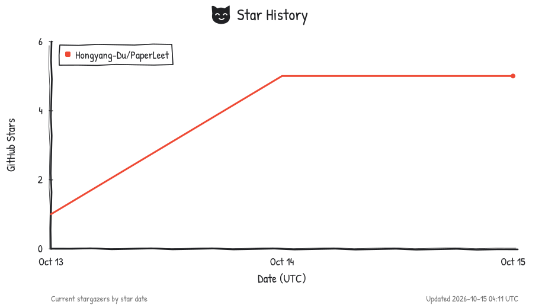
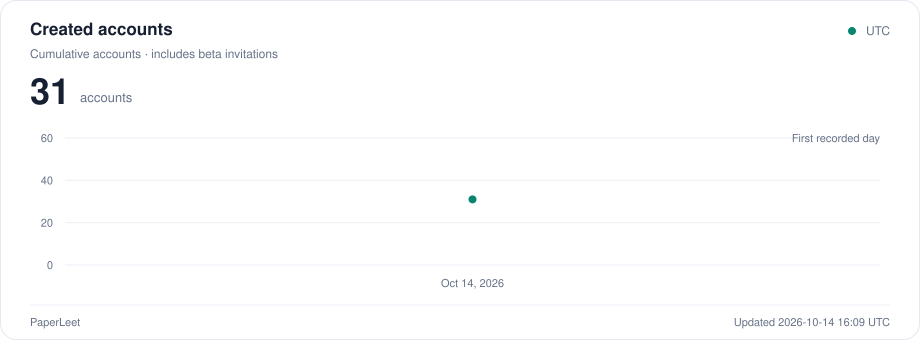
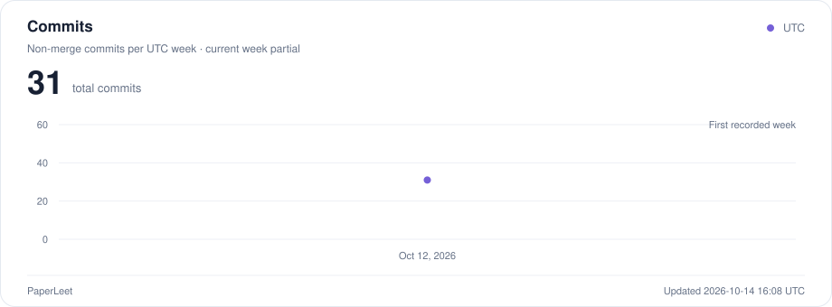

# PaperLeet

<picture>
  <source media="(prefers-color-scheme: dark)" srcset="web/public/brand/paperleet-logo-dark.svg">
  
</picture>

[English](README.md) | **简体中文** · [访问内测](https://paperleet.com) · [快速开始](#快速开始) · [部署](#部署)

## 项目趋势

<picture>
  <source media="(prefers-color-scheme: dark)" srcset="docs/metrics/stars-dark.svg">
  
</picture>

<details>
<summary>账号增长与每周 Commit 曲线</summary>

<picture>
  <source media="(prefers-color-scheme: dark)" srcset="docs/metrics/users-dark.svg">
  
</picture>

<picture>
  <source media="(prefers-color-scheme: dark)" srcset="docs/metrics/commits-dark.svg">
  
</picture>

账号曲线统计累计创建账号数，包含尚未使用的内测账号，不代表活跃用户数。公开数据仅包含日期和数量汇总。

</details>

每日更新。[统计口径与更新方式](docs/metrics.md)。

## 我们想做什么

AI 的进展很快，刚入门时很容易被新论文、新模型和新名词淹没。PaperLeet 希望帮助**准备找工作、刚开始接触 research 的同学**，一次掌握一个核心想法：选一篇论文，亲手实现其中的重要模块，再用测试和小实验验证理解。

我们想做一个**去中心化的开源 research 社区**。每个人都可以贡献论文、讨论想法、改进题目，也可以 fork 项目，为自己的小组独立部署。题库由社区共同建设，经过人工评审后持续扩充。

目前内测包含 **46 篇论文、60 道核心练习**，支持中英文在线编程与自动判题、个人做题记录与每日活跃日历，以及社区发帖、回复和关注。在线答题目前使用管理员发放的内测账号和访问码。

## 快速开始

需要 Python 3.10+、Node.js 20.19+。

```bash
git clone https://github.com/Hongyang-Du/PaperLeet.git
cd PaperLeet
python3 -m venv .venv
source .venv/bin/activate
python -m pip install -e .
npm --prefix web ci
make dev
```

打开 **http://127.0.0.1:5173**，选择论文，补全模块，点击**运行全部测试**。以后用 `make dev` 启动，Ctrl-C 停止两个服务。本地练习的 Python 代码在自己的电脑上运行。

## 部署

多人邀请制内测使用 Docker 部署包：

| 部署位置 | 操作指南 |
| --- | --- |
| 服务器 + 域名 | [服务器部署](docs/hosting.zh-CN.md)：HTTPS、隔离判题、数据持久化与备份。 |
| 自己的电脑 + 域名 | [Cloudflare Tunnel](docs/cloudflare-tunnel.zh-CN.md)：Docker 运行内测服务，电脑需保持开机、联网和不休眠。 |

初期可使用[内测账号](docs/test-accounts.zh-CN.md)，凭登录名和访问码登录，无需邮箱注册。账号、帖子和答题数据保存在部署环境的私有数据库卷中，备份也不要放到 GitHub。配置与启动步骤见对应指南。

## 论文题库

涵盖 LLM 基础、RL、Post-training、Diffusion & Flow、JEPA / World Models 和视觉生成。每篇论文拆成聚焦核心机制的练习，提供辅助代码与测试；部分模块包含 CPU toy 实验。

<details>
<summary>展开全部 46 篇论文与 60 个核心模块</summary>

| 论文编号 | 论文 | 核心范围 | 模块编号 |
| --- | --- | --- | --- |
| 1 | GAE | 实现 GAE 的反向递推和 episode 边界处理。 | 1 |
| 2 | PPO | 实现 clipped surrogate 及其梯度行为；价值损失、归一化和统计代码已提供。 | 2 |
| 3 | DPO | 实现偏好损失与隐式奖励；token 对齐和序列 log-prob 计算已提供。 | 3 |
| 4 | DeepSeekMath · GRPO | 选取论文的 GRPO 模块：组内相对优势、截断目标和回答级聚合。 | 4 |
| 5 | Dr. GRPO | 实现去除组内标准差缩放与固定生成长度归一化这两处修正。 | 5 |
| 6 | DDPM | 实现闭式前向加噪，以及高斯后验和 epsilon 参数化的反向一步；调度器与采样循环已提供。 | 6, 8 |
| 7 | Progressive Distillation | 先实现 v 参数化转换，再推导两步教师到一步学生的蒸馏目标并验证更新。 | 7, 26 |
| 8 | DDIM | 实现 DDIM 单步更新和干净端点；时间步选择、循环与反演探索代码已提供。 | 9 |
| 9 | Flow Matching | 实现条件路径、目标速度和 CFM 回归损失；时间采样、Euler 积分和训练辅助代码已提供。 | 10 |
| 10 | GSPO | 实现序列概率比与 GSPO 损失，验证掩码、截断区域和梯度。 | 11 |
| 11 | GKD · On-policy Distillation | 实现学生 rollout 和全词表散度；在小型自回归模型上验证。OPD 在此指 on-policy distillation。 | 12 |
| 12 | DAPO | 实现组筛选与 token 级目标；采样系统和分布式训练不在本模块范围。 | 13 |
| 13 | LoRA | 实现低秩增量和线性前向，验证冻结边界及小型回归学习。 | 14 |
| 14 | QLoRA | 实现分块 NF4 量化、反量化与适配器前向；不模拟双重量化或分页优化器。 | 15 |
| 15 | MeanFlow | 实现平均流的 JVP 目标和梯度边界，并运行小型生成实验。 | 16 |
| 16 | JiT | 实现 x-prediction 到速度的转换与去噪目标，使用论文启发的低维流形嵌入实验。 | 17 |
| 17 | Drifting Models | 实现漂移场与停止梯度损失，在小型二维分布上验证生成器行为。 | 18 |
| 18 | DMD | 实现 score 差目标与配对回归项，用解析双峰分布检查模式覆盖。 | 19 |
| 19 | DMD2 | 实现双时间尺度更新与辅助目标，在小型实验中验证参数更新边界。 | 20 |
| 20 | Consistency Models | 实现边界参数化和相邻时刻的一致性蒸馏损失。 | 21 |
| 21 | Transformer | 分五题实现缩放点积注意力、多头注意力、LayerNorm 与 Add & Norm、正弦位置编码、逐位置 FFN。 | 22, 27–30 |
| 22 | AdamW | 实现矩估计、偏差修正与解耦权重衰减的一步更新。 | 23 |
| 23 | FlashAttention | 实现分块递推与重缩放。这是 CPU 算法练习，不评价 GPU kernel 性能。 | 24 |
| 24 | CLIP | 实现特征归一化、温度缩放和双向对比损失，使用小型配对检索实验。 | 25 |
| 25 | GLM-5 | 分别实现 Muon Split 逐头正交化、异步 RL 的双边重要性采样修正。 | 31–32 |
| 26 | Kimi K3 | 分别实现有界 KDA 递推、块级注意力残差、SiTU-GLU，并重绘论文的门函数和激活曲线。 | 33–35 |
| 27 | OPSD | 双上下文因果对齐与逐词表项散度截断。 | 36, 37 |
| 28 | SDPO | 同题反馈路由、reverse KL 与 top-k 尾部概率聚合。 | 38, 39 |
| 29 | REPA | 逐 patch 表征对齐损失与梯度边界。 | 40 |
| 30 | Rotation Trick | 保持量化前向值的旋转梯度变换。 | 41 |
| 31 | Differential Transformer | 已投影张量上的差分注意力与 lambda 参数化。 | 42 |
| 32 | Block Diffusion | 拼接干净和含噪 token 的单次前向注意力掩码。 | 43 |
| 33 | DistiLLM-2 | 教师轨迹的 skew KL 与学生轨迹的 skew reverse KL。 | 44 |
| 34 | PKPO | 连续奖励变换、policy loss 与论文的一维 Gaussian toy。 | 45 |
| 35 | SVDQuant | 平滑、SVD 低秩分解与 4-bit 残差前向。 | 46 |
| 36 | MoGe | 截断加权 L1 的鲁棒最优估计。 | 47 |
| 37 | DAPS | 线性 Gaussian 后验 score、Langevin 与独立重新加噪。 | 48 |
| 38 | DiffusionNFT | 正负 beta 隐式速度、双分支目标与微型训练。 | 49 |
| 39 | VAR | 下一尺度条件输入与注意力掩码；多尺度残差量化与重建。 | 50–51 |
| 40 | FD-Loss | 总体矩的 EMA、可微 Fréchet 距离和停止梯度的损失归一化。 | 52–53 |
| 41 | VICReg | 方差、视图一致性与非对角协方差损失。 | 54 |
| 42 | LeJEPA · SIGReg | 特征函数高斯性统计与随机切片聚合。 | 55 |
| 43 | VISReg | 尺度、切片形状、中心与多视图一致性。 | 56 |
| 44 | I-JEPA | 教师目标块、预测损失与 EMA 更新。 | 57 |
| 45 | LeWorldModel | 联合预测目标与潜空间 rollout；终点代价与 CEM 精英重拟合。 | 58–59 |
| 46 | Causal-JEPA | 保留身份锚点的对象遮挡及历史、未来预测。 | 60 |

</details>

## 一起建设

欢迎贡献论文、讲解和测试，也欢迎改进 UI、账号管理、社区与部署。直接提 Issue 或 PR 即可，新题经过人工评审后进入题库。

[贡献指南](CONTRIBUTING.md) · [使用与维护手册](docs/guide.zh-CN.md) · [论文提交 Harness](docs/paper-submission-harness.md)

感谢 [TorchCode](https://github.com/duoan/TorchCode) 对动手学习 ML 的呈现方式带来的启发。
